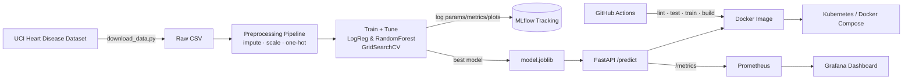

# Heart Disease Prediction — End-to-End MLOps

[](.github/workflows/ci.yml)

A production-ready machine learning solution that predicts the risk of heart
disease from patient health data and serves it as a cloud-ready, monitored API.
The project covers the full MLOps lifecycle: data acquisition, EDA, feature
engineering, model development, experiment tracking, reproducible packaging,
CI/CD, containerization, Kubernetes deployment, and monitoring.

---

## 1. Architecture



## 2. Project Structure

```
heart-disease-mlops/
├── data/                   # raw & processed datasets (regenerated by scripts)
├── scripts/download_data.py
├── src/
│   ├── config.py           # central paths & constants
│   ├── data_preprocessing.py
│   ├── eda.py              # professional EDA visualizations
│   ├── train.py           # training, tuning, MLflow tracking
│   ├── schemas.py         # pydantic request/response models
│   └── api.py             # FastAPI serving app + Prometheus metrics
├── tests/                  # pytest unit & integration tests
├── docker/Dockerfile
├── docker-compose.yml      # api + prometheus + grafana
├── monitoring/             # prometheus.yml + grafana provisioning
├── deployment/
│   ├── k8s/                # raw manifests (namespace, deploy, svc, ingress, hpa)
│   └── helm/heart-disease-api/
├── .github/workflows/ci.yml
├── reports/                # figures + final report
├── requirements.txt / environment.yml
└── run_pipeline.sh
```

## 3. Setup (clean install)

```bash
# 1. Create and activate a virtual environment
python3 -m venv .venv
source .venv/bin/activate

# 2. Install dependencies
pip install -r requirements.txt
```

Conda alternative:

```bash
conda env create -f environment.yml
conda activate heart-disease-mlops
```

## 4. Run the Pipeline Locally

```bash
# End-to-end: download -> EDA -> train
bash run_pipeline.sh

# Or step by step:
python scripts/download_data.py     # -> data/raw/heart_disease.csv
python -m src.eda                   # -> reports/figures/*.png
python -m src.train                 # -> models/model.joblib + mlruns/
```

## 5. Experiment Tracking (MLflow)

Every training run logs parameters, cross-validated and test metrics, the ROC
curve and confusion matrix, and the serialized model.

```bash
mlflow ui --backend-store-uri ./mlruns
# open http://localhost:5000
```

## 6. Serve the API

```bash
uvicorn src.api:app --host 0.0.0.0 --port 8000
# Interactive docs: http://localhost:8000/docs
```

Make a prediction:

```bash
curl -X POST http://localhost:8000/predict \
  -H "Content-Type: application/json" \
  -d @sample_request.json
```

Example response:

```json
{
  "prediction": 1,
  "label": "Disease",
  "confidence": 0.87,
  "probability_disease": 0.87
}
```

Endpoints: `GET /health`, `POST /predict`, `POST /predict/batch`,
`GET /metrics`, `GET /docs`.

## 7. Docker

```bash
# Build the serving image (model is baked in)
docker build -f docker/Dockerfile -t heart-disease-api:latest .

# Run locally
docker run -p 8000:8000 heart-disease-api:latest
curl -X POST http://localhost:8000/predict -H "Content-Type: application/json" -d @sample_request.json
```

Full stack with monitoring:

```bash
docker compose up --build
# API        http://localhost:8000/docs
# Prometheus http://localhost:9090
# Grafana    http://localhost:3000  (admin/admin)
```

## 8. Testing & CI/CD

```bash
flake8 src tests scripts
pytest --cov=src
```

GitHub Actions ([ci.yml](.github/workflows/ci.yml)) runs on every push/PR:
1. **Lint** (flake8 + black)
2. **Unit tests** with coverage
3. **Train** the model and upload artifacts (model, metrics, figures)
4. **Build & smoke-test** the Docker image

The pipeline fails on any lint/test/build error with clear logs.

## 9. Kubernetes Deployment

Raw manifests:

```bash
kubectl apply -f deployment/k8s/namespace.yaml
kubectl apply -f deployment/k8s/
kubectl get pods -n heart-disease
kubectl port-forward -n heart-disease svc/heart-api 8000:80
```

Helm:

```bash
helm install heart-api deployment/helm/heart-disease-api -n heart-disease --create-namespace
```

For Minikube, build the image into the cluster first:
`eval $(minikube docker-env) && docker build -f docker/Dockerfile -t heart-disease-api:latest .`

## 10. Monitoring & Logging

* The API emits structured logs for every request.
* Prometheus scrapes `/metrics` (default FastAPI metrics + custom
  `heart_predictions_total` and `heart_prediction_latency_seconds`).
* A pre-provisioned Grafana dashboard visualizes prediction volume, class
  distribution, latency p95, and request rate.

## 11. Dataset

UCI Heart Disease (processed Cleveland), 303 records, 13 features + binary
target. The target is binarised (0 = no disease, >0 = disease). Downloaded
automatically by `scripts/download_data.py`.

## 12. Reproducibility

* Fixed `RANDOM_STATE`; deterministic train/test split persisted to disk.
* The full preprocessing + model is a single scikit-learn `Pipeline`, so the
  exact transforms used in training are reused at inference — no skew.
* Pinned dependencies in `requirements.txt`.

See the full write-up in [reports/REPORT.md](reports/REPORT.md).
