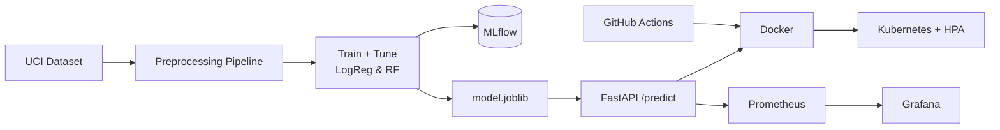

# Heart Disease Prediction — MLOps Project Report

**Course:** Machine Learning Operations (MLOps) AIMLCZG523 — Assignment 01
**Problem:** Predict the risk of heart disease from patient health data and
deploy the solution as a cloud-ready, monitored API.
**GitHub Repository:** https://github.com/agartanu-git/heart-disease-mlops

---

## 1. Setup & Installation

```bash
python3 -m venv .venv && source .venv/bin/activate
pip install -r requirements.txt

# End-to-end pipeline
bash run_pipeline.sh          # download -> EDA -> train
uvicorn src.api:app --port 8000   # serve
```

Conda alternative: `conda env create -f environment.yml`.

All scripts execute from a clean checkout; paths are resolved relative to the
project root (`src/config.py`), and dependencies are pinned in
`requirements.txt`.

---

## 2. Data Acquisition & EDA

**Dataset:** UCI Heart Disease (processed Cleveland) — 303 records, 13
features, 1 target. Downloaded automatically by `scripts/download_data.py`
(honours HTTP/HTTPS proxy, with a mirror fallback).

**Cleaning** (`src/data_preprocessing.py`):
- `?` markers coerced to `NaN`; duplicates dropped.
- Multi-class severity target (0–4) binarised to **0 = no disease / 1 = disease**.
- All features coerced to numeric.

**Class balance:** 164 negative vs 139 positive — fairly balanced, so accuracy
is a reasonable headline metric alongside ROC-AUC.

**Visualizations** (in `reports/figures/`):
| Figure | File |
|---|---|
| Class balance | `class_balance.png` |
| Feature histograms by class | `histograms.png` |
| Correlation heatmap | `correlation_heatmap.png` |
| Boxplots by target | `boxplots.png` |

Key EDA findings: `cp` (chest pain type), `thalach` (max heart rate, negatively
correlated with disease), `oldpeak`, `ca`, and `thal` show the strongest
association with the target.

---

## 3. Feature Engineering & Model Development

**Preprocessing pipeline** (fitted only on training data to avoid leakage):
- Numeric (`age, trestbps, chol, thalach, oldpeak`): median impute → standard scale.
- Categorical (`sex, cp, fbs, restecg, exang, slope, ca, thal`): most-frequent
  impute → one-hot encode (`handle_unknown="ignore"`).

**Models trained** (each inside a full `Pipeline`, tuned with `GridSearchCV`,
5-fold stratified CV, scored on ROC-AUC):
1. Logistic Regression — grid over `C`, `penalty`, `solver`.
2. Random Forest — grid over `n_estimators`, `max_depth`, `min_samples_split`.

**Results (held-out 20% test set):**

| Model | CV ROC-AUC | Test Acc | Precision | Recall | F1 | Test ROC-AUC |
|---|---|---|---|---|---|---|
| **Logistic Regression** ✅ | 0.899 | **0.885** | 0.839 | 0.929 | 0.881 | **0.966** |
| Random Forest | 0.903 | 0.836 | 0.821 | 0.821 | 0.821 | 0.944 |

**Model selection:** Logistic Regression was selected as the production model
(highest test ROC-AUC = 0.966 and best recall = 0.93, which matters for a
screening task where missing a positive case is costly). Best hyper-parameters:
`C=0.1, penalty=l2, solver=liblinear`.

---

## 4. Experiment Tracking (MLflow)

`src/train.py` logs **every run** to MLflow (`./mlruns`):
- Parameters: model type + tuned hyper-parameters.
- Metrics: `cv_roc_auc` and all test metrics.
- Artifacts: ROC curve, confusion matrix, and the serialized sklearn model.

```bash
mlflow ui --backend-store-uri ./mlruns   # http://localhost:5000
```

Experiment name: `heart-disease-classification`.

---

## 5. Model Packaging & Reproducibility

- Final pipeline persisted with `joblib` → `models/model.joblib` (preprocessing
  + estimator in one object, so inference uses the exact training transforms).
- Metrics summary → `models/metrics.json`.
- Deterministic train/test split (`RANDOM_STATE=42`) saved to
  `data/processed/{train,test}.csv`.
- Pinned `requirements.txt` + `environment.yml`.

---

## 6. CI/CD & Automated Testing

**Tests** (`tests/`, pytest) — 13 tests covering:
- Data cleaning (binarisation, dedup, missing-value handling).
- Preprocessing (no NaNs after transform, unknown-category robustness).
- Model (metric computation, pipeline fit/predict).
- API integration (`/health`, `/predict`, validation 422, `/metrics`).

```
13 passed in ~2s
```

**GitHub Actions** (`.github/workflows/ci.yml`) on every push/PR:
1. Lint (flake8) + format check (black).
2. Unit tests with coverage.
3. Download data + **train model**, upload model/metrics/figures as artifacts.
4. Build Docker image + smoke-test `/health`.

The pipeline fails on any lint/test/build error with clear logs.

---

## 7. Containerization

`docker/Dockerfile` — multi-stage, non-root user, Python-based healthcheck,
model baked in.

```bash
docker build -f docker/Dockerfile -t heart-disease-api:latest .
docker run -p 8000:8000 heart-disease-api:latest
```

Verified locally: container reports `Up (healthy)` and `/predict` returns
`{"prediction":0,"label":"No Disease","confidence":0.5742,...}` for the sample
input.

---

## 8. Production Deployment

**Kubernetes** manifests (`deployment/k8s/`): namespace, Deployment (2 replicas,
readiness/liveness probes, resource limits), LoadBalancer Service, Ingress, and
HPA (CPU-based, 2→6 replicas). A parameterised **Helm chart** is provided in
`deployment/helm/heart-disease-api/`.

```bash
# Minikube
eval $(minikube docker-env)
docker build -f docker/Dockerfile -t heart-disease-api:latest .
kubectl apply -f deployment/k8s/
# or: helm install heart-api deployment/helm/heart-disease-api -n heart-disease --create-namespace
```

Place deployment screenshots in `reports/screenshots/`.

---

## 9. Monitoring & Logging

- **Structured logging** of every request/response in the API.
- **Prometheus** metrics at `/metrics`: default FastAPI HTTP metrics plus custom
  `heart_predictions_total{predicted_class}` and
  `heart_prediction_latency_seconds`.
- **Grafana** dashboard (auto-provisioned) visualising prediction volume, class
  distribution, latency p95, and request rate.

```bash
docker compose up --build
# API http://localhost:8000 | Prometheus :9090 | Grafana :3000 (admin/admin)
```

---

## 10. Architecture



---

*Results reproduced locally with Python 3.9, scikit-learn 1.5.1.*
